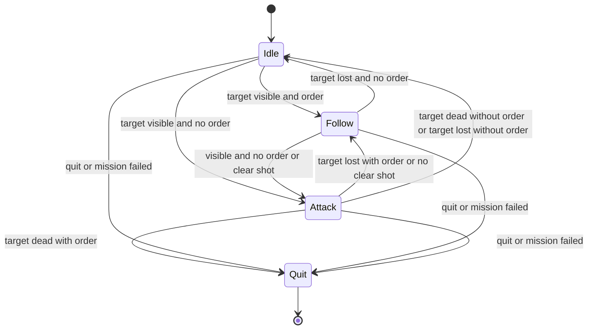

# Console State Machine in C++

A small, turn-based console project that models an AI-style **state machine** (Idle → Follow → Attack → Quit) in modern C++. It was built as a learning project to practice object-oriented design, abstract interfaces, smart pointers, and a clean separation of responsibilities.

> 📹 **Demo:** _add a link to your LinkedIn post or drop a GIF here_

---

## Features

- **Abstract `IState` interface** with `Enter`, `Update`, `Exit` and `GetStateID`
- **Four concrete states:** `IDLE`, `FOLLOW`, `ATTACK`, `QUIT`
- **`StateMachine`** that owns exactly one current state through `std::unique_ptr` and performs all transitions
- **Factory function** that creates a state object from a `StateID` (`enum class`)
- **Shared context (`gameContext`)** holding the world flags, passed by reference
- **Forced transition to Quit** from any state (quit key or mission failed)
- **Mission verdict** printed once by the Quit state: accomplished, aborted or failed

---

## How it works

Each state decides where to go next by **returning a `StateID`** from `Update()`. The machine compares that id with the current one and, only if it changed, performs the switch.



### One tick of the machine

1. If the machine is not running, return.
2. Save the current state's id.
3. Choose the next id: if quit or mission-failed is set, it is `Quit` (the state's `Update` is skipped); otherwise ask the current state via `Update(ctx)`.
4. If the next id differs from the saved id: call `Exit()` on the old state, create the new state with the factory, call `Enter()` on it.
5. If the current state is `Quit`: run its `Update()` once (prints the verdict) and stop the machine.

### Transition rules

| From | Condition | To |
|---|---|---|
| Idle | target visible and order received | Follow |
| Idle | target visible and no order | Attack |
| Idle | otherwise | Idle |
| Follow | target not visible and no order | Idle |
| Follow | target visible and (no order or clear shot) | Attack |
| Follow | otherwise | Follow |
| Attack | target dead and order received | Quit |
| Attack | target dead and no order | Idle |
| Attack | target not visible and no order | Idle |
| Attack | target not visible and order received | Follow |
| Attack | order received and no clear shot | Follow |
| Attack | otherwise | Attack |
| Any | quit requested or mission failed | Quit |

### Mission verdict (Quit state)

| Situation | Verdict |
|---|---|
| Target is dead | Mission Accomplished |
| Target alive and quit requested | Mission Aborted |
| Target alive and mission failed | Mission Failed |

### World rules

The input layer keeps the flags consistent so the states stay simple:

- A dead target is never visible.
- A target that is not visible never has a clear shot.
- "Dead" is one-way: once the target is dead, it stays dead.

---

## Controls

Every turn prints the current flags and a menu:

| Key | Action |
|---|---|
| `Enter` | Pass the turn without changing anything |
| `C` | Change conditions (asks: target dead? visible? clear shot? order received?) |
| `Q` | Request quit |
| `F` | Mark the mission as failed |

Questions that no longer make sense are skipped (for example, a dead target is not asked whether it is visible). Closing the input stream (Ctrl+Z) ends the program.

### Example session (trimmed)

```text
Starting off with the IDLE state.
Target Visible : No
Order Received : No
Clear Shot on Target : No
Target Dead : No
Enter = pass turn | C = change conditions | Q = quit | F = mission failed
c
Is the target DEAD? (y/n): n
Is the target visible? (y/n): y
Is there a clear shot on the target? (y/n): y
Is the order received? (y/n): n
Target found but no order received, switching to ATTACK.
Exiting the Idle state.
Entering the Attack state.
...
c
Is the target DEAD? (y/n): y
Is the order received? (y/n): y
Exiting the Attack state.
Entering the Quit state.
Mission has ended : Mission Accomplished.
---THE END---
```

---

## Project structure

| File | Purpose |
|---|---|
| `StateHolder.h` | `StateID` enum class (Idle, Follow, Attack, Quit) |
| `GameContext.h` | `gameContext` struct with the shared flags |
| `I_State.h` | `IState` abstract interface |
| `States.h` | `IDLE`, `FOLLOW`, `ATTACK`, `QUIT` state classes |
| `StateMachine.h / .cpp` | Owns the current state, runs `Tick`, contains the state factory |
| `WorldInput.h / .cpp` | Reads console input and is the only code that writes the flags |
| `Program1.cpp` | `main`: creates the context, input and machine, then runs the loop |

Dependencies point one way: `main` → machine and input → states → context. Nothing points back, so there are no circular includes.

---

## Build and run

**Requirements**

- Windows with **Visual Studio 2022 or newer** (workload: *Desktop development with C++*)
- C++14 or newer (C++17 recommended): *Project → Properties → C/C++ → Language → C++ Language Standard*

**Steps**

1. Clone the repository.
2. Open the `.sln` file in Visual Studio.
3. Select **Debug / x64**.
4. Press **Ctrl+F5** (run without debugging, so the console stays open).

---

## Design notes

- **`Update()` returns the next `StateID`** instead of switching states itself. A state therefore never destroys itself while it is still executing, states do not need to know about the machine, and all creation and destruction happens in one place.
- **`IState` has a virtual destructor.** The machine deletes states through a base-class pointer (`unique_ptr<IState>`), which is undefined behavior without it.
- **Single ownership with `std::unique_ptr`.** The machine is the only owner of the current state. Everything else uses references.
- **The context lives outside the states.** States are destroyed and recreated on every transition, so data stored inside a state would be lost. One shared context also gives every state the same view of the world.
- **Only `WorldInput` writes the flags.** If a flag ever has a strange value, there is exactly one place to look.
- **Quit is a real state.** It acts as an end-of-mission report, while the machine alone decides when the program stops.

---

## Known limitations and ideas

- Input is turn-based (one command per turn), not real-time.
- There is no "new target" reset, so each run handles one target.
- Follow does not react to a dead target on its own; only Attack does.
- No automated tests yet.
- Possible next steps: derive the flags from raw world data (distance, health), add a state stack (for a pause state), and port the pattern to Unity.

---

## License

_Add a license of your choice (for example MIT)._

## Author

**[Your Name]** · [LinkedIn](https://www.linkedin.com/) · [GitHub](https://github.com/)
